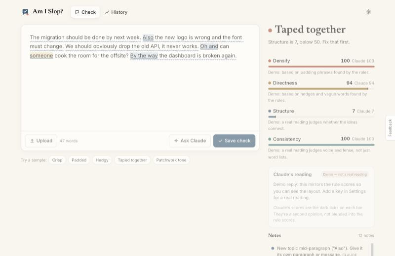
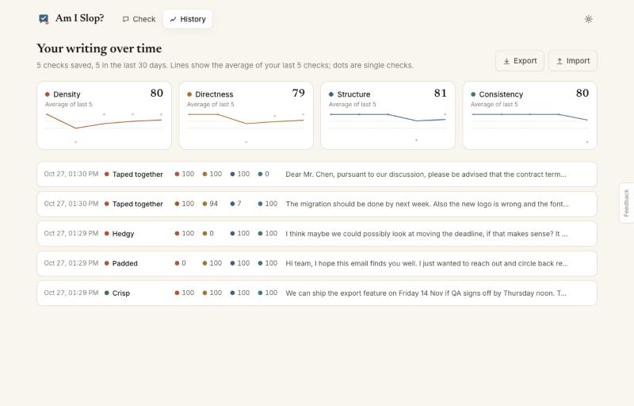

# Am I Slop?

Paste a message you wrote. See right away whether it reads crisp, or padded, hedgy and taped together, with every problem highlighted and a fix next to it.

**[Open the app →](https://amalmehta.github.io/AmISlop/)**

Four separate scores, with no blended total: **Density** (padding), **Directness** (hedges, vague words), **Structure** (topic jumps, walls of text, claims without reasons) and **Consistency** (formal and casual mixed). Rules run instantly in your browser. **Ask Claude** adds a second opinion on meaning, using your own API key.

- Private by default: no server and no account. History stays in your browser, with JSON export.
- The scoring formulas are shown in the app. Their constants are hand-tuned guesses and are labelled that way.

**Docs:** [Instructions](docs/INSTRUCTIONS.md) · [System design](docs/SYSTEM-DESIGN.md) · [File structure](docs/FILE-STRUCTURE.md) · [Prompt log](docs/PROMPTS.md)
