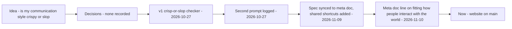
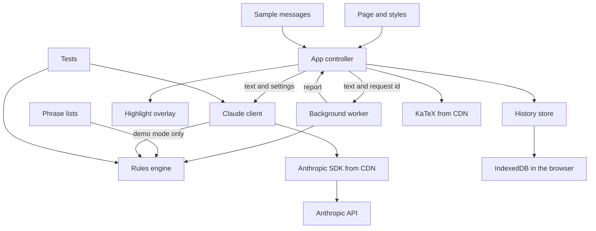
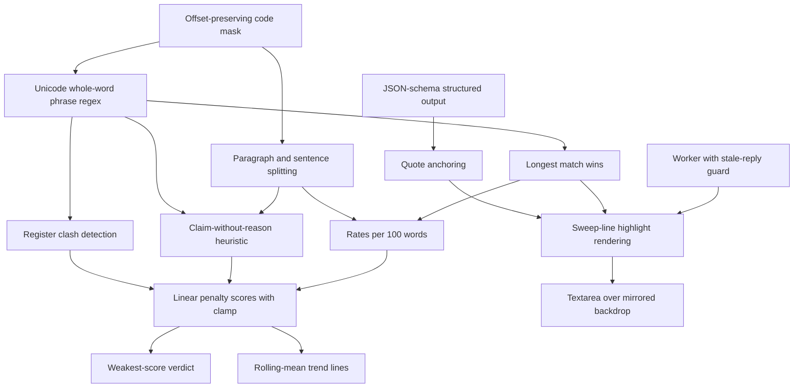

<!-- ProjectForge explainer at 2986b8b -->
# How AmISlop? was built

Am I Slop? is a single web page. You paste a message you are about to send, such as a Slack reply, an email or a PR description, and it tells you whether the message reads crisp or like slop. It is for anyone who wants to catch padding, hedging and rambling before they hit send. The core idea is to split "slop" into four things you can count (padding, hedges, structure and tone), score each one separately with a formula you can read, and treat Claude as an optional second judge rather than blending its opinion into those scores.

## Build history

- **2026-10-27, v1:** The first version of the checker landed in one commit. It is the website described below.
- **2026-10-27, second prompt logged:** A second prompt was added to the prompt log. The README links the log as `docs/PROMPTS.md`.
- **2026-11-09, spec synced:** The spec (`AmISlop?.md`) was updated to match the current meta doc, and the shared shortcuts (`Shortcuts.md`) were added. `CLAUDE.md` points to both.
- **2026-11-10, meta doc line:** The meta doc's line about fitting how people naturally interact with the world was added to the spec (`AmISlop?.md:212`).

The sessions recorded no decisions, so none appear here.

## Code map

| Part | File | What it does |
|---|---|---|
| Page and styles | `index.html`, `css/style.css` | Holds the markup for the Check and History views and the Settings and "How scores work" dialogs, and lays the textarea over the highlight layer. |
| App controller | `js/app.js` | Wires up every event: typing, files, samples, save, Ask Claude, history, settings, routing and keyboard shortcuts. |
| Sample messages | `js/samples.js` | Five invented messages, each with the verdict it should get. |
| Background worker | `js/worker.js` | Runs `analyze` off the main thread and echoes back the request id it was sent. |
| Rules engine | `js/analyzer.js` | A pure function that takes text and returns flags, four scores and a verdict. |
| Phrase lists | `js/lexicon.js` | Hand-written lists of padding, hedge, vague, topic-shift, claim, reason, formal and casual phrases. |
| Highlight overlay | `js/app.js` (`renderBackdrop`) | Draws coloured `<mark>`s behind the text using a sweep over span edges. |
| Claude client | `js/claude.js` | Builds the API request, calls Claude with the user's own key, and turns the reply into scores and anchored notes. |
| Anthropic SDK | `js/claude.js` (`SDK_URL`) | `@anthropic-ai/sdk@0.133.0`, loaded from jsDelivr the first time it is needed. |
| History store | `js/store.js` | Saves, lists, deletes, exports and imports checks in IndexedDB. |
| KaTeX | `js/app.js` (`#how-btn` handler) | Loaded the first time someone opens "How scores work", to typeset the formulas. |
| Tests | `tests/analyzer.test.mjs`, `tests/claude.test.mjs` | Node's built-in test runner (`npm test`), covering the samples, edge cases, a speed limit and reply parsing. |

There is no server and no build step. `package.json` has only a test script, and `app.js` is loaded as a native ES module from `index.html`.

## Concepts

**Offset-preserving code mask.** Before any rule runs, everything inside backticks (fenced blocks and inline code) is replaced with spaces, and newlines are kept. The text keeps exactly the same length, so every character position found later still points at the right place in the original message. Without this, code like `` `maybe_retry()` `` would be flagged as a hedge. It lives in `maskCode` in `js/analyzer.js`.

**Unicode whole-word phrase regex.** Each phrase list entry is a fragment of regular-expression source, not a literal string. For example, `"hope you('re| are) (doing )?well"` is one entry. `rx` wraps each fragment in a lookbehind, `(?<![\p{L}\p{N}'’])`, and a lookahead, `(?![\p{L}\p{N}])`. That way a phrase matches only as whole words, in any alphabet, so "just" does not fire inside "justification". `apos` rewrites every `'` to `['’]`, so curly apostrophes (as in "don’t") match too. The flags `giu` make matching global, case-insensitive and Unicode-aware. This lives in `rx`, `apos` and `compile` in `js/analyzer.js`, and the phrases are in `js/lexicon.js`. One stale detail: the comment in `lexicon.js` says `~` marks an optional apostrophe, but no entry uses `~`. Entries write `'?` instead, and the code never handles `~`.

**Paragraph and sentence splitting.** A paragraph is a run of lines with no blank line between them. A sentence is text up to `.`, `!`, `?` (plus any closing quote or bracket), a newline, or the end of the paragraph. Pieces with no letter or digit are dropped. Each sentence is stored as start and end positions, not as copied text. Sentence count feeds the average sentence length, and sentence boundaries drive the topic-jump and claim rules. It lives in `segment` in `js/analyzer.js`.

**Longest match wins.** Phrases overlap. "I just wanted to" is padding, but "just" on its own is a hedge. `dedupe` sorts the matches longest first and keeps a byte array marking which characters are already taken. It keeps a match only if none of its characters are taken. The cost grows with the total length of the matches, not with the number of pairs, which matters on a 5,000-word paste. It lives in `dedupe` in `js/analyzer.js`. The test "longest match wins" checks it.

**Rates per 100 words.** Counts are divided by message length so that a long message is not punished just for being long. Words are runs of letters or digits, optionally joined by `'`, `’` or `-` (`countWords`). Padding is counted in words (`countWords(s.match)`), but hedges and vague words are counted in matches. Concrete details come from `CONCRETE_RE`: a single digit, a weekday name, a month followed by a number, a URL, an `@name` or a `#123`. Because `\d` matches each digit on its own, "14 Nov" counts as two details. The `concreteCap` limit below stops that from running away. This lives in `analyze` (`per100`) in `js/analyzer.js`.

**Claim-without-reason heuristic.** A sentence is a claim if it contains an absolute word from `CLAIMS`, such as *should*, *must*, *always*, *is wrong* or *obviously*. A claim counts as supported if that sentence or the next one contains a digit or a word from `REASONS`, such as *because*, *since*, *so*, *if* or *for example*. Questions (sentences ending in `?`) are skipped. The help dialog in `index.html` calls this "a rough heuristic": it flags some fine sentences and misses reasons phrased other ways. It lives in the "Claims without reasons" block of `analyze` in `js/analyzer.js`.

**Register clash detection.** Register means formal or casual voice. The engine finds formal words (`FORMAL`), and casual words (`CASUAL`) plus any emoji, matched by the Unicode property `\p{Extended_Pictographic}`. The number of clashes is $\min(f, k)$. Whichever register appears first in the message is treated as the base, and every word from the other register gets flagged. So "Dear Mr. Chen… lol tbh" flags "lol" and "tbh", not "Dear". It lives in the "Consistency" block of `analyze` in `js/analyzer.js`.

**Linear penalty scores with clamp.** Each score starts at 100, loses a fixed number of points per unit of each problem, and is then rounded and clamped to the range 0 to 100. The constants are in `PARAMS` in `js/analyzer.js`. The file's own comment calls them "invented parameters, tuned by hand on the bundled samples, not validated on real data", and the help dialog says the same. With $p$ = padding words per 100 words, $\bar a$ = average sentence length, $h, v, c$ = hedges, vague words and concrete details per 100 words, $m$ = topic jumps, $w$ = paragraphs over 100 words, and $u$ = share of sentences that are unsupported claims:

$$D = 100 - 5p - 2\max(0,\ \bar a - 22)$$
$$R = 100 - 6h - 3v + \min(10,\ 2c)$$
$$S = 100 - 15m - 15w - 60u$$
$$C = 100 - 20\min(f,\ k)$$

$D, R, S, C$ are Density, Directness, Structure and Consistency. The same formulas are typeset in the "How scores work" dialog in `index.html`.

**Weakest-score verdict.** There is no total score. The verdict looks only at the lowest of the four. Under 8 words the verdict is "Too short". If every score is 75 or more, it is "Crisp". If the lowest score is under 50, the verdict is named after that dimension: "Padded" for density, "Hedgy" for directness, and "Taped together" for both structure and consistency. Anything else is "Mostly crisp". A ruler-style minimum is used because an average would let one strong score hide one bad one. It lives in `verdict` in `js/analyzer.js`.

**Worker with stale-reply guard.** A Web Worker is a background thread in the browser. The app waits 120 ms after the last keystroke (debounce), then posts `{id, text}` to `js/worker.js`. Each request gets a new, higher `reqId`. When a report comes back, `app.js` uses it only if its id equals the latest `reqId`, so an answer for text you have already changed is thrown away. If the worker cannot start (for example when the page is opened from `file://`), `refresh` runs `analyze` on the main thread instead. The same "is this still for the current text?" check guards Claude replies through `claudeFresh`, which compares `claude.forText` to the textarea. This lives in `refresh` and the worker setup in `js/app.js`.

**Textarea over mirrored backdrop.** A `<textarea>` cannot colour parts of its own text. So a `
` sits behind it with the same font, padding and wrapping (`white-space: pre-wrap`), and with transparent text. The textarea's background is transparent. The coloured `<mark>` backgrounds in the backdrop therefore show through exactly under the matching words, while you still type into a real textarea. `renderBackdrop` adds `"\n "` at the end so the last line has the same height in both layers. This lives in `css/style.css` (`.backdrop, #input` rules) and `renderBackdrop` in `js/app.js`.

**Sweep-line highlight rendering.** Highlights can overlap. A claim underline covers a whole sentence that also contains a hedge, and Claude's notes can overlap the rule flags. HTML tags cannot overlap, so `renderBackdrop` collects every span start and end as a "cut point", sorts them, and walks them once. It keeps a set of the spans that are open at each point. Each stretch between two cut points becomes one `<mark>` carrying the classes of every open span and their ids in `data-f`. Hovering a note then lights up every mark whose `data-f` includes that note's id. Rendering is capped at 600 rule flags because, per the code comment, painting thousands costs about a second. It lives in `renderBackdrop` in `js/app.js`.

**JSON-schema structured output.** The request to Claude sets `output_config.format` to a JSON Schema (`SCHEMA`) that requires `summary`, `scores`, `reasons` and `notes`, forbids extra fields, and limits `dimension` to the four names. This makes the reply a fixed shape the UI can read. `parseReply` still defends against bad replies: it clamps scores to 0 to 100, maps an unknown dimension to `structure`, keeps at most 8 notes, and turns `refusal`, `max_tokens` or unparseable JSON into plain error messages. Requests to Opus and Sonnet also send `fallbacks: "default"` with the beta `server-side-fallback-2026-07-01`. The code comment says this makes the API retry on a suitable model if a safety classifier declines. This lives in `SCHEMA`, `buildRequest` and `parseReply` in `js/claude.js`.

**Quote anchoring.** Claude is told to quote an exact substring for each note. `parseReply` finds the quote with `text.indexOf(quote)`. If it is found, the note gets start and end positions and is highlighted. If it is not found (because Claude paraphrased), the note is kept but left unanchored. It shows in the list with its quote in front and highlights nothing, so it never marks the wrong words. This lives in `parseReply` in `js/claude.js` and `renderNotes` in `js/app.js`.

**Rolling-mean trend lines.** The History view draws one small SVG per score. Dots are single saved checks, oldest to newest, skipping checks under 8 words. The line is the mean of each check and up to 4 before it. The headline number is the mean of the last 5 checks, and the arrow compares it with the 5 before that. Grid lines sit at 75 and 50, the verdict thresholds. This lives in `trendSvg` and `renderHistory` in `js/app.js`, and checks come from `listChecks` in `js/store.js`.

## One input, start to finish

The input is the message used in `tests/claude.test.mjs`:

> I think we should maybe ship on Friday. Also the logo is wrong.

1. **Typing.** The textarea's `input` listener in `js/app.js` calls `autosize`, restarts a 120 ms debounce timer, and restarts a 400 ms timer that saves the draft to `localStorage` under `amislop.draft`.
2. **Dispatch.** When the debounce fires, `refresh` (`js/app.js`) sees the text is not empty, increments `reqId`, and posts `{id, text}` to the worker.
3. **Worker.** `self.onmessage` in `js/worker.js` calls `analyze(text)` and posts back `{id, report}`.
4. **Mask and count.** In `analyze` (`js/analyzer.js`), `maskCode` changes nothing because there are no backticks. `countWords` finds 13 words.
5. **Split.** `segment` returns one paragraph with two sentences: positions 0–39 ("I think … Friday.") and 40–63 ("Also the logo is wrong.").
6. **Word rules.** `findAll(WORD_RULES, …)` matches the hedges "I think" (0–7) and "maybe" (18–23). `dedupe` keeps both because they do not overlap. There is no padding and no vague word. `CONCRETE_RE` matches "Friday", so there is 1 concrete detail.
7. **Topic jump.** For every sentence after the first, the engine tests the first 24 characters against `TOPIC_SHIFTS`. "Also" matches at position 0 of sentence two, so it is one shift at 40–44.
8. **Walls.** No paragraph is over 100 words, so there are none.
9. **Claims.** Sentence one contains "should". Neither it nor sentence two contains a digit or a `REASONS` word, so it is unsupported. Sentence two contains "is wrong" and has no next sentence, so it is also unsupported. That makes $u = 2/2 = 1$.
10. **Register.** No formal or casual words and no emoji, so `mixed` is 0.
11. **Scores.** Hedges are $2 \times 100/13 \approx 15.4$ per 100 words, and concrete details are $\approx 7.7$ per 100.
    - Density: no padding, and the average sentence of 6.5 words is under 22, so it is **100**.
    - Directness: $100 - 6(15.4) + \min(10,\ 15.4) \approx 17.7$, which rounds to **18**.
    - Structure: $100 - 15(1) - 60(1)$ = **25**.
    - Consistency: **100**.
12. **Verdict.** In `verdict`, the lowest score is Directness at 18, which is under 50. The result is **"Hedgy"**, with the line "Directness is 18, below 50. Fix that first."
13. **Flags.** Each flag gets its `dim` and a `note` from `NOTE`. For example: `Hedge: "I think" softens the point. Try: cut it, or give the reason.` Flags are sorted by start position, with whole-sentence claim flags placed after word flags at the same position.
14. **Reply accepted.** Back in `js/app.js`, `worker.onmessage` checks that `e.data.id === reqId`, stores the report, and calls `renderCheck`.
15. **Render.** `renderCheck` runs five renderers:
    - `renderBackdrop` cuts the text at 0, 7, 18, 23, 39, 40, 44 and 63. The first piece becomes `<mark class="directness u-structure" data-f="r0 r1">`, meaning a hedge colour plus the claim's wavy underline.
    - `renderVerdict` shows "Hedgy".
    - `renderScores` draws the four bars.
    - `renderClaude` hides the Claude panel, since there is no reply yet.
    - `renderNotes` lists five notes: two hedges, one topic jump and two claims.
16. **Ask Claude (optional, ⌘⇧↵).** `runClaude` (`js/app.js`) sets `claude = {forText, loading}` and calls `askClaude` (`js/claude.js`).
    - With no key and demo mode off, it throws a message telling you to add a key.
    - With a key, it loads the SDK, and `buildRequest` wraps the text in `<message>` tags. It sets `effort: "low"`, `max_tokens: 4000` and the schema, and adds the fallback beta for Opus or Sonnet, so the call goes to `client.beta.messages.create`.
    - `parseReply` clamps the scores and anchors each quote. A quote of "Also the logo is wrong" anchors at 40.
    - Claude's scores show up as dark ticks on the bars and its notes as accent underlines. They are never averaged into the rule scores.
17. **Save (⌘↵).** `saveCheck` (`js/app.js`) builds `{id, createdAt, text, words, scores, verdict, claude}`. The `claude` field holds a real reply only; demo replies are dropped. `store.saveCheck` (`js/store.js`) `put`s it into the `checks` object store of the `amislop` IndexedDB database.
18. **History.** Opening `#history` calls `route`, then `renderHistory`, which loads `listChecks` (newest first). This check adds a dot to each trend line and a row to the list. Clicking the row loads the text back into Check through `setText`.

## Where this came from

Written from the spec, the decisions, git history and the code as of the latest commit (2986b8b, 2026-11-10).
