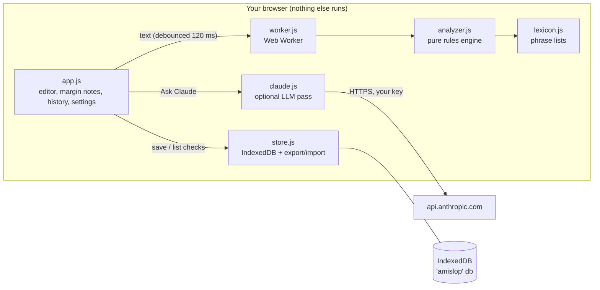

# System Design — Am I Slop?

**What it is.** A static website that reads a message you wrote and says whether it is crisp or slop, on four separate scores. It runs entirely in your browser. The only thing that ever leaves the page is the optional "Ask Claude" request, and that goes straight to Anthropic using your own key.

**Who it's for.** One person first: someone who writes a lot of Slack messages, emails and PR descriptions and wants to (1) fix a draft before sending it and (2) see whether their writing gets better over weeks.

**The one result that makes it worth it.** You paste a draft, and within a second you see which phrases pad it out, which ones hedge, and where it jumps between topics. You fix them, and the History tab shows the scores rising over time.

## Architecture

| Component | Job | Interface |
|---|---|---|
| `js/lexicon.js` | Phrase lists for padding, hedges, vague words, topic shifts, claims, reasons, formal and casual register. Each entry can carry a suggested fix. | Plain exported arrays |
| `js/analyzer.js` | Turns text into `{ words, sentences, paragraphs, flags[], scores{density,directness,structure,consistency}, verdict }`. Pure function with no DOM and no I/O, so it can be tested in Node. | `analyze(text) → Report` |
| `js/worker.js` | Runs `analyze` in a Web Worker so typing never waits. Replies for text that has since changed are dropped. Falls back to the main thread on `file://`. | `postMessage({id, text}) → {id, report}` |
| `js/store.js` | Saves checks in IndexedDB. Lists and deletes them, and exports or imports JSON. | `saveCheck`, `listChecks`, `deleteCheck`, `exportAll`, `importAll`, `clearAll` |
| `js/claude.js` | Builds the rubric prompt, calls the Messages API through the official SDK (loaded only when first needed), and parses the JSON reply. Includes a labelled demo mode that needs no key. | `askClaude(text, settings) → ClaudeReport` |
| `js/samples.js` | Sample messages (crisp, padded, hedgy, taped together, mixed tone) for first use and for tests. | Exported array |
| `js/app.js` | UI: editor with inline highlights, margin notes, score bars, history with trend lines, settings (⌘,), feedback link, file upload, drag-and-drop, paste. | DOM |

Each piece sits behind one small interface. To swap the rules engine (say, for a local model), replace `analyze`. To sync history, replace `store.js`. To use a proxy server instead of a key in the browser, replace the `fetch` target inside `claude.js`.

## Main flows

1. **Live check.** You type or paste. After 120 ms with no keystroke, the worker runs `analyze` and the highlights, notes and scores update in place, while the last result stays on screen until the new one arrives. Measured: a keystroke costs about 1 ms on the main thread for a 300-word message, and `analyze` takes 1–3 ms warm for 600 words and about 30 ms for a 4,000-word text with 2,400 flags. The first call compiles the regexes (about 200 ms), inside the worker at load. Highlights are capped at 600 and notes at 150, because painting 4,000 highlights took about 1 s.
2. **Save.** ⌘↵ or "Save check" writes `{id, createdAt, text, words, scores, verdict, claude?}` to IndexedDB. The History view reads it back and draws one trend line per score.
3. **Ask Claude.** The text and a fixed rubric are sent to the model, which returns JSON with four scores (each with a reason) and notes tied to exact quotes. The result appears beside the rule scores as a second opinion and is never merged into them, so the two can be compared.
4. **Files.** The Upload button, dropping a file anywhere on the window, or pasting a file with ⌘V all read `.txt`, `.md` or `.eml` as text into the editor.

## Where data lives

- **History:** IndexedDB database `amislop`, store `checks`, in this browser only. There is no server and no account. If you clear site data, the history is gone, so Settings has a JSON export and import for backup.
- **Settings:** in `localStorage` (`amislop.settings`): theme, model, key, demo mode.
- **API key:** in `localStorage`, readable by any script on this page. The site loads no analytics or third-party scripts except the pinned Anthropic SDK and KaTeX from jsDelivr, and only when they're needed. The trade-off is that a shared computer can read the key, which Settings warns about.

## Key decisions and trade-offs

| Decision | Why | Cost |
|---|---|---|
| Static site with no build step (plain ES modules) | The simplest thing that holds: GitHub Pages hosts it for free, there's nothing to compile, and you can open the files and read them. | No TypeScript and no bundling. Fine at this size (about 1.5k lines). |
| Rules first, LLM optional ("hybrid") | Rules are instant, free, private and explainable: every point lost points to a phrase. The LLM is there for what rules can't see: whether ideas connect and whether claims have reasons. | Two scores that can disagree. That is deliberate and shown as such. |
| Four scores, never one total | One total hides which dimension is weak and is easy to game, for example by writing shorter messages. | More to read. Mitigated by a one-word verdict on top. |
| Thresholds are invented parameters | No validated "slop" metric exists for chat messages. The numbers were tuned on the bundled samples and are labelled as estimates in the UI. | They may not fit your writing. Real data will show whether they do (see INSTRUCTIONS). |
| Key in the browser, sent directly to Anthropic | No server to host, secure or pay for. You pay only for your own checks. | The key is visible to anyone with access to this browser profile. It's not suitable for a public multi-user tool. |
| Default model `claude-opus-5-5` at `low` effort, with server-side refusal fallback | Best judgement of meaning. At low effort a 300-word check costs about 1–2¢. Sonnet 5.5 and Haiku 5.5 are in Settings if cost matters more. | Opus is pricier than Haiku. That's your call in Settings. |
| History as IndexedDB rather than a file | Works offline and needs no permissions. Fast with up to 10k checks. | Tied to one browser. Export it to move. |

## Scale: what changes, and when

- **Today:** one user, at most a few thousand checks. IndexedDB `getAll` is under 50 ms at that size.
- **Over 10k checks:** paginate History with an index cursor instead of `getAll`.
- **Multiple devices:** replace `store.js` with a sync backend (for example, a small Supabase table) behind the same interface.
- **Other people using your hosted copy:** keys in the browser stop being acceptable. Add a proxy with rate limits and auth, and decide who pays.
- **A Mac app later:** wrap the same `js/` modules in a WebView (Tauri). The analyzer is already DOM-free.

## Testing

- `npm test` (32 tests, no dependencies). `tests/analyzer.test.mjs` runs the five samples in `js/samples.js` (each must get its expected verdict) plus edge cases: empty, very short, emoji-only, curly apostrophes, words inside other words, code blocks, a topic marker at a paragraph start, claims with reasons, questions, a 5,000-word wall (must run under 200 ms), flag offsets, and adversarial score bounds.
- `tests/claude.test.mjs` checks request shape and reply parsing, including malformed JSON, refusals, truncation, clamped scores, and quotes that aren't in the text, using canned replies (no network).
- The browser flows were driven end to end in a real browser, including a live call to the API with an invalid key.
- A manual review checklist covers feel, smoothness and live API calls: see [INSTRUCTIONS.md](INSTRUCTIONS.md#manual-review-checklist).

## Known limits

- English only. The phrase lists are curated, not learned, so they miss slop made of clean words with empty ideas. That's what Ask Claude is for.
- "Claims without reasons" in the rules engine is a heuristic: a sentence with an absolute word (*should, must, always, clearly*) and no reason word (*because, since, so that*, a number) in it or the next sentence. It will flag some fine sentences.
- Register mixing only looks at word lists, not syntax.

## Build outline and next steps (in order)

1. Analyzer + lexicon + tests. ✅ v1
2. Editor with live highlights, margin notes, scores, samples. ✅ v1
3. History in IndexedDB, with trend lines and export/import. ✅ v1
4. Settings, feedback link, file input, icon. ✅ v1
5. Ask Claude with demo mode. ✅ v1
6. *Deferred:* calibrate thresholds on 30+ of your real messages (needs your data).
7. *Deferred:* a rewrite suggestion ("crisper version"). It's a proposal, not in scope.
8. *Deferred:* a browser extension or Mac menu-bar app that checks before you send.
9. *Deferred:* personal phrase list (your own tics).
10. *Deferred:* multi-device sync.

Steps 6–10 only need `analyze()` to stay pure and `store.js` to stay behind its interface, and both are true today.
